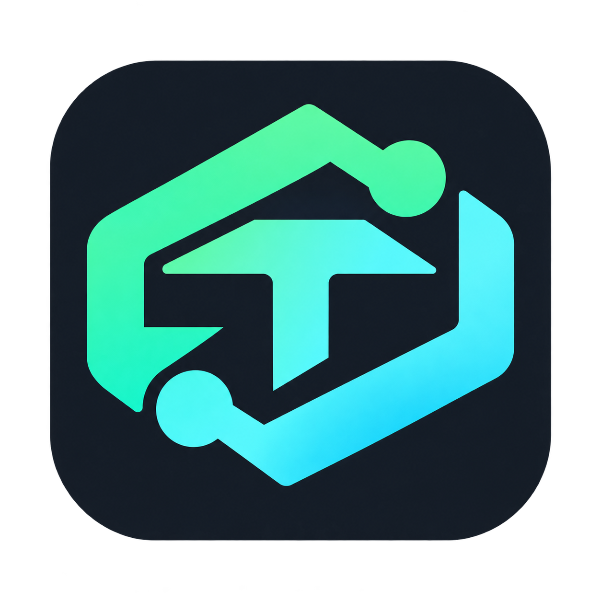

<p align="center">
  
</p>

<h1 align="center">TRAE Relay for DSH</h1>

<p align="center">把 TRAE CN / TRAE SOLO CN 账号的模型额度接入 DeepSeek Harness，在原生对话菜单里直接使用。</p>

<p align="center">
  <a href="LICENSE"></a>
  
  
  
  
</p>

[English](README.en.md) · [上游项目](README.upstream.md) · [使用指南](docs/usage.zh-CN.md)

---

## 这是什么

一个 **DeepSeek Harness 插件**。安装后它在本机回环地址上运行一个 OpenAI / Anthropic 兼容的代理服务，DSH 通过标准 `openai-completions` 协议调用它，**消耗的是你 TRAE 账号的额度**，无需额外 API 费用。

导入账号后，即可在 DSH 输入框的模型菜单里选择 TRAE 提供的模型（DeepSeek、GLM、Kimi、Qwen、Doubao、MiniMax 等），并调节思考强度。

> 本项目基于 [FuSheng-cs/Trae2api-dsh](https://github.com/FuSheng-cs/Trae2api-dsh)（MIT）二次开发，修复了若干实际使用中的问题，详见 [本仓库的改动](#本仓库的改动)。

## 功能

| 功能 | 说明 |
| --- | --- |
| **额度接入** | 导入 TRAE 账号，在 DSH 中调用模型并使用账号额度 |
| **模型发现** | 从账号实际能力发现模型，按真实 context window / maxTokens / 思考档位注册 |
| **思考强度** | 把 TRAE 的 `light / high / extra_high` 映射为 DSH 的 `low / high / max` |
| **多账号** | 导入多个账号、切换、轮询调度、按剩余积分排序 |
| **自动签到** | 按北京时间每日签到，跳过已签到账号 |
| **用量统计** | 积分、Token、缓存命中、请求记录与每日汇总 |
| **内嵌控制台** | 完整的账号 / 用量 / 设置界面，也可在新窗口打开 |
| **生命周期管理** | 随 DSH 启动，DSH 关闭时自动回收，绝不残留孤儿进程 |

## 快速开始

### 1. 克隆仓库

```bash
git clone https://github.com/fssae/DSH-tool.git
```

### 2. 环境要求

| 环境 | 要求 |
| --- | --- |
| DSH | 已验证 0.2.0-rc.2+ |
| Node.js | ≥ 22 |
| Python | ≥ 3.10（需含 `venv` 与 `pip`） |
| 账号 | 本机已安装并**已登录** TRAE CN / TRAE SOLO CN |

### 3. 安装到 DSH

在 DSH 插件管理器中添加本仓库的插件目录，或用 DSH 自带的插件 CLI 指向该路径。安装后插件会随 DSH 启动。

### 4. 首次配置

打开左侧边栏 **TRAE 控制台**：

1. 点 **准备环境** — 创建独立的 Python 虚拟环境并安装依赖，**不影响你的系统 Python**
2. 点 **启动服务** — 代理在 `127.0.0.1` 上启动，仅本机可访问
3. 选择 **Trae CN**，点 **导入当前桌面账号** — 只读本机 TRAE 客户端登录信息
4. 返回控制台 → **DSH 模型管理** → 接入模型菜单

完成后即可在对话输入框的模型菜单里选择 TRAE 的模型。

> 面板右上角的 **使用说明** 按钮内置完整文档与 FAQ。

## 安全设计

| 项目 | 行为 |
| --- | --- |
| 监听地址 | 仅 `127.0.0.1`，局域网与公网不可访问 |
| 模型接口鉴权 | 需要 API Key（自动生成，存于插件数据目录） |
| 控制台鉴权 | 需 DSH 当场签发的临时票据（30 秒有效）+ HttpOnly 会话 Cookie |
| 跨站防护 | 仅接受本机回环来源；远程 / 局域网 / `null` 来源一律拒绝 |
| 凭证来源 | 从本机 TRAE 客户端**只读**解密，不经任何第三方服务器 |
| 网络出口 | 仅访问 TRAE 官方接口 |

## 生命周期管理

代理进程由 supervisor 托管，绑定 DSH 宿主进程。关闭 DSH 后，**三道防线**保证进程被完整回收：

| 层 | 机制 | 覆盖场景 |
| --- | --- | --- |
| 1 | Windows Job Object `KILL_ON_JOB_CLOSE` | 正常退出，宿主句柄关闭即杀整树 |
| 2 | supervisor `WaitForMultipleObjects` 监控 owner | 宿主异常退出 |
| 3 | relay 内 `_owner_watchdog`（5 秒轮询） | 代理被手动 / 脱离方式启动的异常路径 |

同时 `start()` 具备**幂等性**：若已有存活且健康的实例，直接复用，不会重复拉起第二份。

实测数据（Windows）：

- 宿主退出 → 整树退出 **1.0 秒**，端口释放
- 无 supervisor 的孤儿进程 → watchdog 兜底 **1.8 秒** 退出

## 本仓库的改动

在 [FuSheng-cs/Trae2api-dsh](https://github.com/FuSheng-cs/Trae2api-dsh) v1.3.1 基础上做了以下修复。

### 1. 修复内嵌控制台跨域被拒

**现象**：在 DSH 中打开控制台，报 `{"error":"Open the console from DSH"}`。

**根因**：控制台以 iframe 形式嵌在 DSH 页面里，iframe 的 Origin 是 DSH 的端口（如 `http://127.0.0.1:58482`），而代理在另一个端口。原代码 `same_origin()` 只允许与自身完全一致的 Origin，因此所有来自 iframe 的请求都被判为跨站而拒绝。

**修复**：`allowed_origin()` 额外放行本机回环来源（`127.0.0.1` / `localhost` / `[::1]`），**远程与局域网来源仍一律拒绝**，访问依旧需要票据 + HttpOnly Cookie 双重校验，安全性不降低。

```python
# runner/relay_entry.py
def allowed_origin(origin, own_origin):
    if origin is None:
        return True
    if origin == own_origin:
        return True
    scheme, sep, authority = origin.partition('://')
    if not sep or scheme not in ('http', 'https') or not authority:
        return False
    host, _, port = authority.rpartition(':')
    if not port.isdigit() or not host:
        host, port = authority, ''
    return host in ('127.0.0.1', 'localhost', '[::1]', '::1')
```

### 2. 修复 `NO_PROXY` 含 `[::1]` 导致全部请求失败

**现象**：上游请求全部报 `Invalid port: ':1]'`，控制台返回 502。

**根因**：部分 Windows 环境的 `NO_PROXY` 含带方括号的 `[::1]`。httpx 0.28.1 的 `trust_env` 会把每个条目当作 URLPattern 解析，`[::1]` 触发 `InvalidURL`，导致**每一个** httpx 客户端构造失败。

**修复**：`normalizedEnvironment()` 在注入子进程前统一剥离方括号并归一化大小写。

### 3. 增强生命周期管理

- `startUnlocked()` 增加幂等判断：已健康运行则复用，不再重复拉起
- relay 内新增 `_owner_watchdog`：宿主消失时自行退出

### 4. 界面改进

- 右上角新增 **使用说明** 按钮，内置完整文档与 FAQ
- 状态徽章（运行中 / 准备中 / 失败）、卡片阴影与悬停反馈、主按钮高亮、折叠式 FAQ

### 5. 移除个人路径

面板不再硬编码任何具体的 Python 安装路径。留空即启用运行时自动发现（`python3` → `python` → `py -3`），准备完成后显示实际使用的解释器。

## 常见问题

<details>
<summary><b>打开控制台提示 <code>Open the console from DSH</code></b></summary>

这是安全设计而非故障：控制台只接受 DSH 当场签发的临时票据（30 秒有效），直接用浏览器访问代理端口或刷新旧链接都会被拒绝。请始终通过左侧 **TRAE 控制台** 进入。

本仓库已修复 iframe 场景下的误拒（见上文改动 1）。
</details>

<details>
<summary><b>服务启动失败</b></summary>

1. 先点 **准备环境** 完成 Python 虚拟环境与依赖安装
2. 检查端口是否被占用
3. 查看数据目录下的 `relay.log` 末尾报错
</details>

<details>
<summary><b>token 过期</b></summary>

插件会在 token 到期前自动刷新。若 `refreshToken` 也过期，请在 TRAE 客户端退出并重新登录，再回来点 **导入当前桌面账号**。
</details>

<details>
<summary><b>模型列表里看不到 TRAE 模型</b></summary>

在控制台 **DSH 模型管理** 中把要用的模型设为显示；被隐藏的模型不会出现在模型菜单中。
</details>

<details>
<summary><b>控制台出现 <code>Invalid port: ':1]'</code></b></summary>

本仓库已修复（见上文改动 2）。若仍出现，检查系统环境变量 `NO_PROXY` 中是否还有带方括号的 IPv6 写法。
</details>

## 目录结构

```
├── index.js               # DSH 插件入口（Host 半）
├── client.js              # 控制台 UI（Client 半）— 含使用说明文档
├── cordis.patch.yml       # 插件挂载条目
├── lib/
│   ├── runtime.js         # 代理生命周期、环境准备、模型同步
│   ├── models.js          # 模型目录与可见性
│   └── console-bridge.js  # Host ↔ 代理 私有通道
├── python/
│   ├── relay_entry.py     # 代理入口 + 访问控制（allowed_origin）
│   ├── supervisor.py      # 进程树托管（Job Object）
│   ├── model_catalog.py   # 模型发现
│   └── console_models.py  # 控制台数据
├── vendor/trae2api-cn/    # 上游代理引擎
└── assets/                # 截图与图标
```

## 免责声明

本项目仅供学习与研究使用。使用本工具调用 TRAE API 所产生的费用与合规问题由使用者自行承担，请遵守 TRAE 平台的使用条款。**请勿将本工具用于商业用途或大规模分发。**

`vendor/` 目录代码版权归各自作者所有，详见 [THIRD_PARTY_NOTICES.md](THIRD_PARTY_NOTICES.md)。

## 许可证

[MIT](LICENSE)
